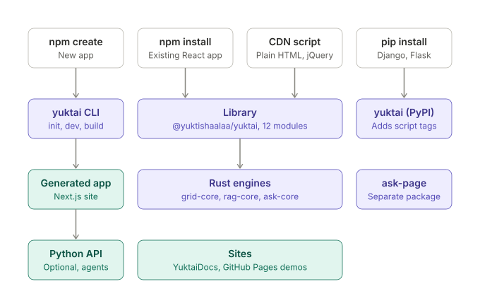
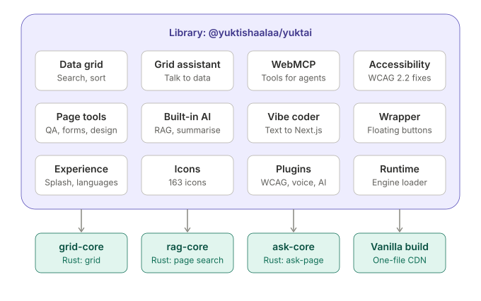
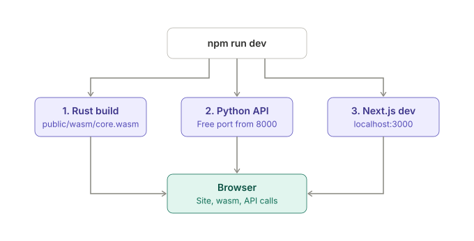
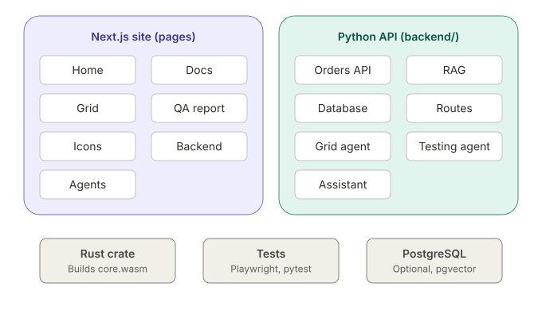

# Architecture

A map of the YuktAI repository: what each part does and how they fit together.

## The big picture

```
               ┌──────────────────────────────┐
  your app ──▶ │  @yuktishaalaa/yuktai         │  library (TypeScript, runs in the browser)
               │  grid · accessibility · icons │
               └──────────────┬───────────────┘
                              │ search and sort
                              ▼
               ┌──────────────────────────────┐
               │  Rust → WebAssembly           │  fast path, embedded in the package
               │  (TypeScript fallback)        │
               └──────────────────────────────┘

  npm create yuktai ──▶ create-yuktai ──▶ yuktai init ──▶ a new Next.js app
                                                          (+ optional Rust, Python API, agents)
```

### Diagrams

The same pictures are on the [YuktAI home page](https://sandeep-miriyala.github.io/yuktai/#how). Source files: [`docs/diagrams/`](docs/diagrams/).

| | |
|---|---|
| **1. The whole picture** |  |
| **2. Inside the library** |  |
| **3. What `npm run dev` does** |  |
| **4. Inside a new app** |  |

Three rules hold everywhere:

1. **The browser does the work.** The library needs no server and no API key.
2. **Rust is a speed-up, never a requirement.** Every Rust engine has a TypeScript fallback that gives the same results, proven by tests.
3. **Everything else is optional.** The Python API and agents only exist in apps that ask for them.

## Folders

| Folder | What it is |
|---|---|
| `src/` | The library `@yuktishaalaa/yuktai` |
| `src/grid/` | `YuktaiGrid`: search, sort, pages, Show all (virtual scrolling), Grid AI Assistant |
| `src/core/`, `src/react/`, `src/next/` | Accessibility widget, page tools, `YuktAIWrapper` |
| `src/experience/` | Loading screen, 7-language UI words, animation preference |
| `src/icons/` | 163 icons |
| `src/grid/rust/`, `src/agentic/rust/` | Load the WebAssembly engines and fall back to TypeScript |
| `rust/grid-core/` | Grid search and sort in Rust |
| `rust/rag-core/`, `rust/ask-core/` | Page search (BM25) in Rust |
| `vanilla/` | One-file build for plain HTML and jQuery (CDN) |
| `packages/yuktai-cli/` | The `yuktai` command and app templates |
| `packages/create-yuktai/` | `npm create yuktai`: a thin wrapper around `yuktai init` |
| `packages/ask-page/` | `@yuktishaalaa/ask-page`: "Ask this page" side panel |
| `python/` | `yuktai` on PyPI: adds the library's `<script>` tags to Django, Flask or FastAPI pages |
| `examples/` | Small working examples |
| `docs/modules/` | Reference notes for individual modules |
| `docs/diagrams/` | Architecture diagrams (SVG, light and dark) |
| `brand/` | Logos used by the README |
| `.github/` | CI on every push, issue and pull request templates |

### Demo site (GitHub Pages)

These files are the live demos at https://sandeep-miriyala.github.io/yuktai/. Moving them would break those links.

| Path | Demo |
|---|---|
| `site/` | The whole website: docs, guides, live demos. Made with YuktAI (Next.js static export + Rust) |
| `vanilla/` | Plain HTML demo, and the source of the one-file CDN build |
| `ask-page/` | "Ask this page" demo (uses the built `ask-page.global.js`) |
| `scripts/site-e2e.mjs` | Opens every page of the built site: errors, broken links, axe-core |

One website, one address: https://sandeep-miriyala.github.io/yuktai/. `.github/workflows/site.yml` builds the library from the
commit, runs the unit and browser end-to-end tests, builds `site/` with that build, adds `vanilla/` and `ask-page/`, checks every
page and publishes to GitHub Pages only when everything passed. It replaces yuktaidocs.netlify.app and the old one-page home.

## The library

- Built with **tsup** into `dist/`. Entry points: `.`, `/icons`, `/experience`, `/head`.
- `/head` has no React, so it is safe inside a Next.js `<head>`.
- Tests: **Vitest** with happy-dom (`npm test`).
- Lint: **Oxlint**. Format: **Biome**.

## Rust engines

- Stable Rust only, pinned in `rust-toolchain.toml` (target `wasm32-unknown-unknown`).
- `npm run build:rust` builds each crate and embeds the `.wasm` in the package, so users install nothing extra.
- Text is ranked once with the browser's collator, then sorted in Rust, so Telugu and other scripts keep the right order.

## The CLI and generated apps

`yuktai init` copies templates from `packages/yuktai-cli/templates/`:

| Template | Adds |
|---|---|
| `base` | Next.js app, header with menus, accessibility, PWA |
| `feature-grid` | `/grid/` page with 25 lakh rows |
| `feature-backend` | Python API (FastAPI), LangGraph agents, PostgreSQL files, Playwright tests |
| `feature-icons`, `feature-page-tools` | Icons guide, QA report |
| `stack-next-rust` | A Rust crate built to WebAssembly by `yuktai dev` |
| `host-netlify`, `host-github-pages` | Hosting files |

In a generated app, `npm run dev` runs `yuktai dev`, which:

1. builds the Rust crate (skipped with a warning if Rust is missing),
2. starts the Python API on a free port (if `backend/` exists),
3. starts `next dev`, telling it where the API is.

Ctrl + C stops all three.

### Python API and agents (optional)

- `backend/app/main.py`: FastAPI. New files in `backend/app/routes/` load by themselves.
- `backend/app/agents/`: LangGraph agents (Grid Agent, Testing Agent, YuktAI Assistant).
- `backend/app/rag.py`: answers from `backend/knowledge/*.md`.
- With a Groq key in `backend/.env` the agents use a language model; without it they use rules ("free mode").
- `YUKTAI_ENV=production` turns the developer agents off.

## Privacy

The library never reads what visitors type into password fields and stores only accessibility preferences in the browser. Anything that sends data away (Groq, your own hooks) is opt-in and documented.

## Releases

| Package | Published from |
|---|---|
| `@yuktishaalaa/yuktai` | repository root |
| `yuktai` | `packages/yuktai-cli/` |
| `create-yuktai` | `packages/create-yuktai/` |
| `@yuktishaalaa/ask-page` | `packages/ask-page/` |
| `yuktai` (PyPI) | `python/` |

Versions follow [semantic versioning](https://semver.org). Changes are listed in [CHANGELOG.md](CHANGELOG.md).
