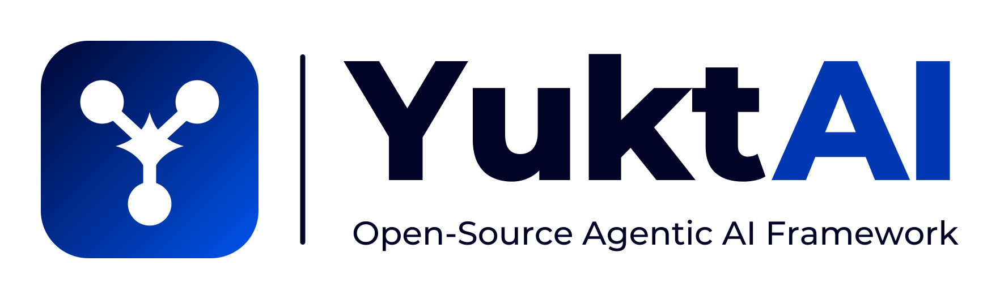
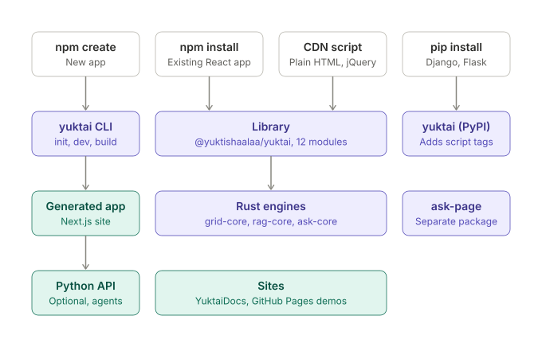

<p align="center">
  <a href="https://sandeep-miriyala.github.io/yuktai/">
    <picture>
      <source media="(prefers-color-scheme: dark)" srcset="https://raw.githubusercontent.com/sandeep-miriyala/yuktai/main/brand/yuktai-logo-dark.png">
      
    </picture>
  </a>
</p>

<p align="center">
  <strong>Web apps everyone can use, in Indian languages.</strong><br>
  Free, open-source toolkit for Next.js, React and plain HTML: WCAG 2.2 accessibility, a Rust-fast data grid for 10 lakh rows,<br>
  and AI that answers from your own data, all in the browser, nothing sent anywhere. One command: <code>npm create yuktai@latest</code>
</p>

<p align="center">
  <a href="https://www.npmjs.com/package/@yuktishaalaa/yuktai"></a>
  <a href="https://www.npmjs.com/package/@yuktishaalaa/yuktai"></a>
  <a href="https://github.com/sandeep-miriyala/yuktai/blob/main/LICENSE"></a>
  <a href="https://github.com/sandeep-miriyala/yuktai/actions/workflows/ci.yml"></a>
  <a href="https://sandeep-miriyala.github.io/yuktai/"></a>
</p>

<p align="center">
  <a href="https://sandeep-miriyala.github.io/yuktai/">Documentation</a> ·
  <a href="https://sandeep-miriyala.github.io/yuktai/create/">Create an app</a> ·
  <a href="https://sandeep-miriyala.github.io/yuktai/grid/">Demos</a> ·
  <a href="CHANGELOG.md">Changelog</a>
</p>

---

## Quick start

```bash
npm install @yuktishaalaa/yuktai
```

```tsx
"use client"
import { YuktaiGrid } from "@yuktishaalaa/yuktai"

const columns = [
  { key: "name", label: "Name", sortable: true },
  { key: "city", label: "City" },
  { key: "amount", label: "Amount", type: "number", sortable: true },
]

export default function Orders({ rows }) {
  return <YuktaiGrid data={rows} columns={columns} rowKey="id" search pagination={{ pageSize: 25 }} />
}
```

That's it. Search, sort, pages, keyboard navigation and phone cards work out of the box.

**No build step?** Use one script tag:

```html
<script src="https://cdn.jsdelivr.net/npm/@yuktishaalaa/yuktai@5.5.4/vanilla/index.min.js"></script>
<script>yuktai.renderGrid("#orders", { data: rows, columns })</script>
```

**Starting a new app?** One command gives you a ready Next.js app:

```bash
npm create yuktai@latest my-app
cd my-app
npm run dev
```

Only Node.js 18+ is needed. Rust and Python are optional extras.

## Why YuktAI?

- **Fast** – search and sort run in Rust (WebAssembly). 10 lakh rows sort in under a second.
- **Accessible** – WCAG 2.2 checks, keyboard support and screen-reader labels built in.
- **Indian languages** – Indian number format (10,00,000), correct sorting for Telugu and other scripts, voice input in 22 Indian languages.
- **Works anywhere** – Next.js, React, plain HTML and jQuery.
- **Free** – GPL-3.0, free forever.

## How it works

<p align="center"></p>

More diagrams (library modules, `npm run dev`, a new app) in [ARCHITECTURE.md](ARCHITECTURE.md).

## What's inside

| | |
|---|---|
| 📊 **Data grid** | Search, sort, filter, pages or one scrolling list, selection, CSV export, themes |
| ♿ **Accessibility** | Contrast, text size, dyslexia font, colour-blind filters, WCAG audit |
| 💬 **Ask this page** | Answers questions from your page content |
| 🎨 **163 icons** | Any size and colour, safe in Server Components |
| 🧩 **YuktAI UI** | 80+ accessible components (buttons, forms, dialogs, tabs, menus…) with the names Material code already uses: change one import line, drop MUI and emotion |

Optional, when you need them: a grid assistant that understands plain words, a loading screen, and a Python API with agents in apps made by `npx yuktai`. See the [docs](https://sandeep-miriyala.github.io/yuktai/).

### YuktAI UI

```tsx
import { Box, Button, Dialog, Stack, Tabs, Tab, TextField } from "@yuktishaalaa/yuktai/ui"

<Stack direction={{ xs: "column", sm: "row" }} spacing={2} sx={{ p: 2, bgcolor: "background.paper" }}>
  <TextField label="Name" helperText="As on your ID" />
  <Button variant="contained">Save</Button>
</Stack>
```

- Same component names and props as Material, so moving an app is a find-and-replace of the import. Ratnalabala moved 91 files this way.
- No runtime dependencies: one small engine for `sx` and system props (spacing, theme colours, responsive values, nested selectors, keyframes).
- Real elements: `<button>`, `<select>`, `<input type="range">`, `<dialog>` (focus trap, Esc, focus goes back).
- WCAG 2.2 by default: 44px targets, 3px focus ring, labels wired to inputs, arrow keys in Tabs and Menus, reduced motion.
- Your CSS variables (`--primary`, `--foreground`, `--border`…) are the theme, so dark mode needs no JavaScript.
- Next.js: send the styles with the server HTML using `getUiStyles()` inside `useServerInsertedHTML` (see the docs).

### Grid that understands plain words (5.7.0)

```tsx
<YuktaiGrid
  data={orders}
  columns={columns}
  rowKey="id"
  label="Orders"                 // the table's name for screen readers
  ai                              // ✨ Assistant button; Chrome's built-in AI plans requests
  getChildren={(o) => o.items}    // ▶ parent and child rows
  devTools                        // ⚙ Developer: Auto / Rust / TypeScript, TS vs Rust chart
/>
```

- **Ask in English or Telugu:** "Hyderabad orders above 1 lakh, biggest first" becomes three checked steps (filter, filter, sort), shown as chips you can remove one by one, with **Undo** and **Reset view**.
- **Safe by design:** the model must answer in a JSON schema; every step is checked against the real tools and columns; at most 5 steps; row text is passed as data, never instructions; downloads ask **Yes / No** first (WebMCP agents too). Unclear requests get a question, not a guess. No browser AI? The built-in rules answer.
- **⚙ settings, top right:** show or hide the assistant, your own colour (text colour picked for 4.5:1), row spacing, and **CSV, Excel, JSON, PDF** downloads of what the grid shows.
- **Accessible:** sort buttons work from the keyboard and announce `aria-sort`; result counts and "no rows match" are announced.
- **Evals:** `runGridEvals(planner, tools)` scores any planner on 50 English and Telugu requests (`GRID_EVAL_SET`).

### Ready for AI browsers (WebMCP)

Add `webmcp` and browser AI agents (Gemini in Chrome and others that speak [WebMCP](https://github.com/webmachinelearning/webmcp)) can search, count, filter and sort your grid through the same tools as the built-in assistant:

```tsx
<YuktaiGrid data={rows} columns={columns} rowKey="id" webmcp webmcpToken={process.env.NEXT_PUBLIC_WEBMCP_TOKEN} />
```

- Uses `document.modelContext.registerTool` (falls back to `navigator.modelContext` in older Chrome). Tools return JSON strings and are marked `readOnlyHint` / `untrustedContentHint`.
- Chrome 149–162 need an [origin trial](https://developer.chrome.com/origintrials) token for your site; pass it as `webmcpToken`. Without one, WebMCP works only where the browser already enables it.
- `onWebMCPStatusChange` reports the real state: `unsupported`, `registering`, `ready`, `partial` or `error`.
- Agents only get what the grid already shows. Nothing the visitor types is read or sent.

## Cheat sheet

### Create an app

| Command | |
|---|---|
| `npm create yuktai@latest my-app` | Create an app (asks a few questions) |
| `npm create yuktai@latest my-app -- --yes` | Create with the defaults |
| `npx yuktai@latest init my-app` | The same, with the `yuktai` command |
| `npx yuktai@latest init my-app --yes` | The same, with the defaults |

### `init` options

| Option | Values | Default |
|---|---|---|
| `--stack` | `next-rust` · `next` | `next-rust` |
| `--template` | `docs` · `starter` | `docs` |
| `--features` | `grid,page-tools,icons,backend` · `none` | all |
| `--host` | `none` · `netlify` · `github-pages` | `none` |
| `--accent` | `blue` · `violet` · `teal` · `orange` | `blue` |
| `--title "My App"` | Site title | |
| `--no-install` | Skip `npm install` | |
| `--no-git` | Skip `git init` | |
| `--yes`, `-y` | Defaults for anything not given | |

```bash
# smallest app: Next.js only, no Rust, no Python
npx yuktai@latest init simple --stack next --features none --yes
```

### Inside your app

| Command | |
|---|---|
| `npm run dev` | Site, Rust build and Python API together (http://localhost:3000) |
| `npx yuktai dev --no-api` | The same without the Python API |
| `npm run build` | Static files in `out/` |
| `npm run lint` | ESLint |
| `npm test` | Site tests |
| `npm run dev:api` | Python API only (http://localhost:8000/docs) |
| `npm run test:api` | API tests (pytest) |
| `npm run test:e2e` | Browser tests (Playwright). First time: `npx playwright install chromium` |
| `npm run agent:test` | Testing Agent: runs every check and explains what failed |
| `npm run assistant` | YuktAI Assistant: `add page contact`, `add api products` |

The last five come with the `backend` feature.

### Library imports

| Import | |
|---|---|
| `@yuktishaalaa/yuktai` | Grid, accessibility, page tools |
| `@yuktishaalaa/yuktai/icons` | 163 icons |
| `@yuktishaalaa/yuktai/experience` | Loading screen, language and animation picker |
| `@yuktishaalaa/yuktai/ui` | YuktAI UI: 80+ accessible components, `sx`, `useTheme`, `useMediaQuery` |
| `@yuktishaalaa/yuktai/head` | Small scripts for `<head>` |

## Live demos

| Site | |
|---|---|
| [miriyalas.github.io/yuktai](https://miriyalas.github.io/yuktai/) | Made with no laptop: created, built and published from a browser with GitHub Codespaces |
| [పద్యాలవాల](https://sandeep-miriyala.github.io/padyalavala/) | Telugu poetry site: Rust search, Grid AI Assistant in Telugu, listen and share |
| [YuktAI site](https://sandeep-miriyala.github.io/yuktai/) | Docs, guides, playgrounds and live demos, in one place |
| [Plain HTML demo](https://sandeep-miriyala.github.io/yuktai/vanilla/) | No framework, one script |

**No laptop?** Open [GitHub Codespaces](https://github.com/codespaces) → Blank, run `npm create yuktai@latest my-app -- --yes`, push, then Settings → Pages → Source: GitHub Actions. [Step by step](https://sandeep-miriyala.github.io/yuktai/create/#codespaces)

## Documentation

Everything else (grid options, styling, accessibility tools, jQuery, the CLI, agents) lives in the docs:

**https://sandeep-miriyala.github.io/yuktai/**

## Packages

| Package | |
|---|---|
| [`@yuktishaalaa/yuktai`](https://www.npmjs.com/package/@yuktishaalaa/yuktai) | This library |
| [`yuktai`](https://www.npmjs.com/package/yuktai) | Create a new app in one command |
| [`create-yuktai`](https://www.npmjs.com/package/create-yuktai) | `npm create yuktai@latest` |
| [`@yuktishaalaa/ask-page`](https://www.npmjs.com/package/@yuktishaalaa/ask-page) | "Ask this page" side panel |

## Compatibility

Next.js 13–16 · React 18–19 · Node 18+ · All modern browsers · jQuery 1.12–4.0

## Contributing

Issues and pull requests are welcome. Start with [CONTRIBUTING.md](CONTRIBUTING.md) and the map in [ARCHITECTURE.md](ARCHITECTURE.md). Please follow the [Code of Conduct](CODE_OF_CONDUCT.md), and read [SECURITY.md](SECURITY.md) before reporting a security problem. What's coming: [ROADMAP.md](ROADMAP.md).

## License

[GPL-3.0](LICENSE) © Sandeep Miriyala, Yuktishaalaa AI Lab
